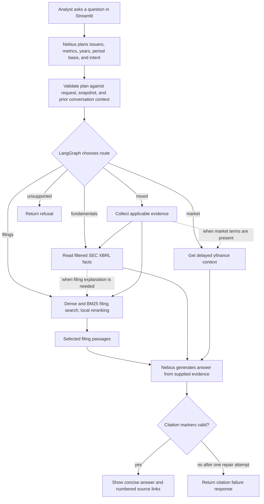
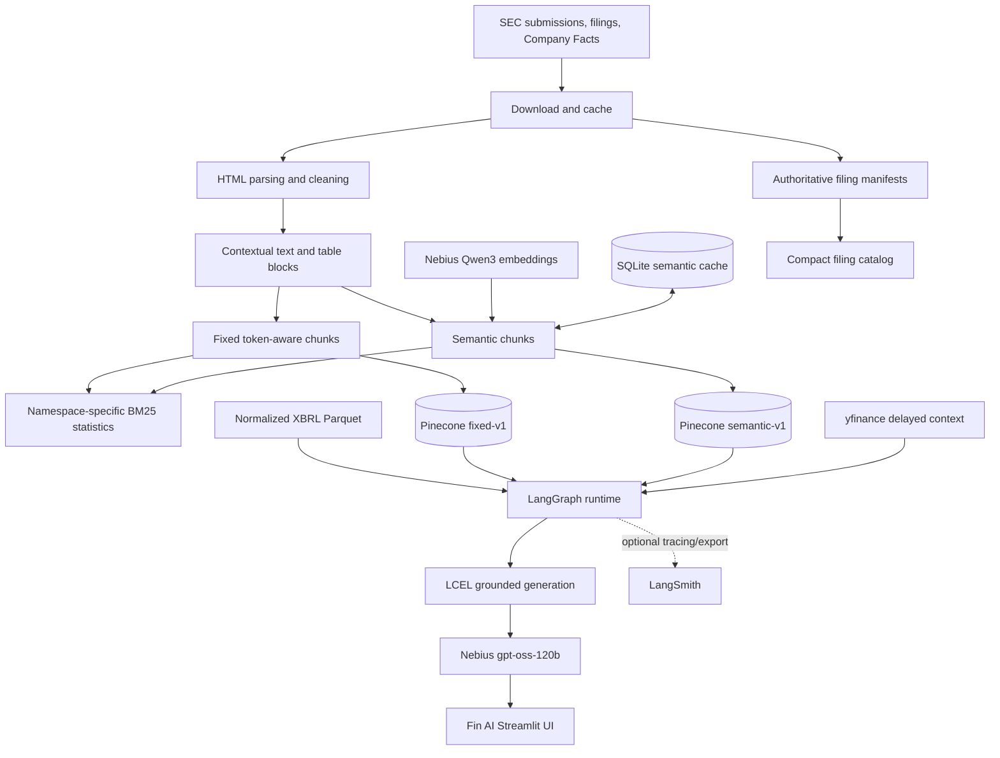
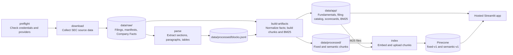
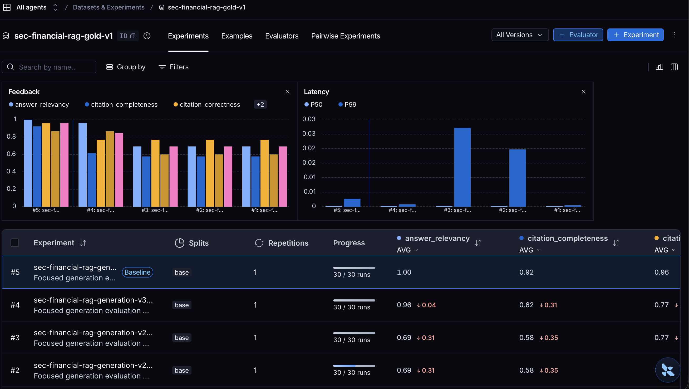

# Fin AI — SEC Intelligence

**Project type:** Financial Document Intelligence RAG application  
**Implementation track:** Python, LangChain, and LangGraph, with optional LangSmith observability  
**Documentation version:** 1.0  
**Last verified:** October 25, 2026
**Financial-data snapshot:** September 30, 2026

## 1. Executive summary

Fin AI is a public, research-only financial intelligence application for exploring SEC filings,
structured financial facts, company trends, peer comparisons, and delayed market context. It is
designed for retail investors and analysts who need evidence-backed answers rather than generic
chatbot commentary.

**Project one-liner:** Fin AI helps public-market researchers answer quantitative and narrative
questions about ten major U.S. issuers from SEC filings and SEC XBRL data in a Streamlit research
terminal, targeting at least 90% groundedness and citation correctness.

The project implements the Financial Document Intelligence assignment from the Week 2 RAG
framework. Its central experiment compares fixed and semantic chunking over identical filing
content, measures retrieval before and after reranking, and generates answers with traceable SEC
evidence. The product does not execute trades, predict prices, or provide personalized investment
advice.

## 2. Assignment rubric and completion mapping

The project is evaluated against both the original Week 2 requirements and the product-specific
acceptance criteria defined during implementation.

| Rubric requirement | Fin AI implementation | Status |
|---|---|---|
| Define a user, question type, corpus, surface, and quality target | Retail/public-market researchers; SEC filing and fundamentals questions; Streamlit; ≥90% groundedness/citation correctness | Complete |
| Use a named financial corpus | SEC EDGAR 10-K/10-Q filings and SEC Company Facts for a frozen ten-issuer universe | Complete |
| Document ingestion and cleaning | Cached SEC acquisition, HTML cleanup, section detection, contextual paragraphs, Markdown tables | Complete |
| Define freshness | Reproducible snapshot dated September 30, 2026; hosted app does not silently mutate the corpus | Complete |
| Implement two chunking strategies | Token-aware fixed chunks and embedding-distance semantic chunks over the same normalized blocks | Complete |
| Use embeddings and a vector store | Nebius Qwen3 embeddings and Pinecone namespaces `fixed-v1` and `semantic-v1` | Complete |
| Use hybrid retrieval | Dense 0.65 plus BM25 sparse 0.35, with local cross-encoder reranking | Complete |
| Compare retrieval quality | Hit@K, evidence Recall@K, MRR@10, nDCG@10, category breakdowns, and reranking deltas | Complete |
| Include refusal behavior | Unsupported/advice route plus evidence-insufficiency and invalid-citation fail-closed paths | Complete |
| Build a working interface | Five-page Fin AI Streamlit experience with company, peer, market, and research workflows | Complete |
| Provide at least 15 evaluation questions | Thirty gold questions across numeric, narrative, trend, comparison, and unanswerable categories | Complete |
| Document prompts, iterations, and learning | Sections 12, 16, and 17 of this document | Complete |
| Submit code and a demonstration | Repository is prepared; public GitHub publication, deployment, and demo recording remain release steps | Pending external action |

### Product acceptance targets

| Measure | Target | Current verified result |
|---|---:|---:|
| Retrieval Hit@10 / evidence Recall@10 | ≥80% | Ensemble: 53.8% / 55.8% |
| Faithfulness / groundedness | ≥90% | 96.2% |
| Citation correctness | ≥90% | 96.2% |
| Citation completeness | Diagnostic | 92.3% |
| Answer relevancy | Diagnostic | 100.0% |
| Refusal correctness | ≥80% | 100.0% |
| Median chat latency | Recorded, not a release gate | 5.42 seconds in the evaluated run |

The generation targets are met. Retrieval remains below the deliberately ambitious 80% target and
is reported as a limitation rather than hidden behind answer-quality scores.

## 3. Product concept and user experience

Fin AI is a research terminal, not a brokerage or trading system. Its interface contains:

1. **Dashboard:** delayed price ticker, issuer universe, financial signals, and research entry
   points.
2. **Company Intelligence:** aligned annual KPIs, definitions, trends, authoritative filing
   history, raw normalized XBRL facts, and SEC links.
3. **Peer Analysis:** Growth, Profitability, Financial Strength, and Balanced scorecards with
   visible drivers, weights, missing-data coverage, and cross-sector warnings.
4. **Research Assistant:** filing and structured-data questions with synthesized answers, inline
   numbered citations, compact references, optional evidence excerpts, and a collapsible live
   research-progress panel.
5. **About & Data:** analyst-facing coverage, source, scoring, and limitation explanations.

The visual system uses a graphite horizontal navigation bar, warm-gray workspace, white research
surfaces, evergreen accents, cobalt links, and semantic green/red market movement. The brand is
**Fin AI**, with the descriptor **SEC Intelligence**. Streamlit controls are restyled for accessible
contrast while the application remains responsive on narrower screens.

### 3.1 Business workflows mapped to implementation

| Analyst task | What the user sees | Data and processing behind it | Where AI/ML is used |
|---|---|---|---|
| Scan the covered market | Dashboard with a horizontal price ticker and reported financial measures | `yfinance` supplies delayed quotes, cached for five minutes; precomputed SEC XBRL scorecard artifacts supply annual revenue growth and operating margin | No LLM is needed to display or calculate these values |
| Investigate one company | Aligned annual KPIs, trends, financial profile, and filing history | The UI reads normalized XBRL facts and derived metrics from Parquet; the separate filing catalog supplies the SEC's official filing and report dates | No LLM is needed for the displayed figures or filing list; the analyst can open Research Assistant for explanations |
| Compare companies | Growth, Profitability, Financial Strength, and Balanced rankings with metric drivers and coverage | Offline calculations align reporting periods, compute ratios, winsorize values, rank the fixed ten-company cohort, and redistribute weights for missing metrics | No LLM assigns ranks; the calculations are deterministic and inspectable |
| Ask about a reported number or trend | A concise answer with numbered SEC references | LangGraph selects normalized SEC XBRL facts for numbers and retrieves relevant filing passages for context | Nebius embeds the question for retrieval; a local cross-encoder reranks passages; Nebius generates the cited explanation |
| Ask about risk, strategy, or disclosures | A synthesized filing answer with links to the original 10-K or 10-Q | The app searches indexed SEC filing paragraphs and tables, applies company/form/year filters, and reranks the matches | Dense embeddings, local reranking, and grounded answer generation are used |
| Ask about today's market context | A clearly labeled delayed quote answer | The market route reads `yfinance`; a question combining market and filing/fundamental terms can also gather SEC evidence | The LLM summarizes available evidence; the market values are not generated by the model |
| Ask for personal advice, a precise prediction, or confidential information | A refusal or evidence-limitation response | The graph applies explicit unsupported-intent rules and stops before retrieval/generation; missing evidence and invalid citations also trigger safe responses | No LLM call is needed for the unsupported-intent refusal |

The SEC corpus is prepared before the hosted app serves questions: `download` collects source
filings and Company Facts, `parse` extracts contextual paragraphs and tables, `build-artifacts`
creates normalized facts and both chunk sets, and `index` writes their dense and BM25 sparse
representations to Pinecone. The dashboard, company, and peer pages read compact artifacts;
Research Assistant additionally queries the existing index and calls the configured model.

### 3.2 What happens when an analyst asks a question



1. **Understand the request.** Streamlit passes the question and any optional company, form,
   year, or retrieval-strategy controls to a LangGraph conversation thread. Nebius first returns
   a structured research plan (issuers, metrics, years, annual/quarterly/YTD basis, and intent).
   The app validates explicit ranges and issuer/metric names before the plan can filter evidence.
   The thread keeps
   company, topic, form, and year context for follow-up questions; clearing the conversation starts
   a new thread.
2. **Choose evidence.** Validated plan fields refine the graph's deterministic safety and routing
   rules; the model cannot bypass unsupported-intent refusals. Multi-year numeric questions select
   the relevant XBRL periods directly, without restricting retrieval to the first year or letting
   a handful of recent quarterly facts displace older annual facts. Filing search is added when
   explanation is needed. A filing request searches passages; a market request reads delayed quotes;
   a mixed request collects the applicable sources. Unsupported requests end at the refusal node.
3. **Retrieve relevant filings when needed.** The question is converted to a Nebius dense
   embedding and a namespace-specific BM25 sparse query. Pinecone returns up to 30 hybrid
   candidates from `fixed-v1`, `semantic-v1`, or both, depending on the requested/automatic
   strategy. For the combined strategy, reciprocal-rank fusion merges the two result sets. The
   local cross-encoder reranks the leading 20 candidates and normally retains eight passages.
4. **Write against evidence.** The selected passages, XBRL records, and/or market facts are
   numbered and supplied to an LCEL prompt chain using Nebius `gpt-oss-120b`. The prompt asks for
   a concise answer with a source marker on every material factual claim, preserving units and
   reporting periods. The model does not receive the entire filing or independently browse SEC.
5. **Check and display.** The generation chain may make one citation-repair attempt. The graph
   validates marker existence and numbering against the supplied evidence and returns an evidence
   limitation or citation failure response when appropriate. Streamlit renders valid `[1]` style
   markers and compact references with issuer, form/source type, date, section, and original URL.
   Evidence excerpts remain available in an optional expander. Marker validation cannot prove
   that the cited passage supports every claim; that requires the separate answer evaluation and
   manual review described in Sections 13–14.

The Research Assistant streams completed LangGraph node updates to a progress panel. It starts
with planning, then shows the validated evidence route, the actual source-collection result, and
answer/citation completion. Route-aware text distinguishes direct XBRL lookups from Pinecone
filing search, market lookups, and unsupported questions; it does not present skipped work as
completed. The panel collapses after the answer and its step log remains expandable in chat
history. This is UI feedback, not a new ingestion stage or a substitute for LangSmith tracing.

For example, **“What was Meta's revenue in 2025?”** resolves to META, year 2025, and the revenue
metric. The fundamentals route filters normalized SEC XBRL facts to that reporting year, retrieves
related filing context, and asks the model to explain the reported figure with SEC references. A
follow-up such as **“How about 2024?”** inherits META and the financial topic from the same
conversation thread while replacing the reporting year. This is retrieval-augmented generation:
the model writes from selected external evidence, while source selection, factual records, and
reference checks are explicit parts of the application.

## 4. Scope, corpus, and data sources

### 4.1 Frozen issuer universe

The versioned manifest represents the ten issuer-level constituents selected for the September 30,
2026 S&P 500 Top 10 snapshot. Alphabet and Berkshire Hathaway share classes are consolidated at
the issuer/CIK level.

| Primary ticker | Issuer | Sector |
|---|---|---|
| NVDA | NVIDIA Corporation | Information Technology |
| AAPL | Apple Inc. | Information Technology |
| MSFT | Microsoft Corporation | Information Technology |
| AMZN | Amazon.com, Inc. | Consumer Discretionary |
| GOOGL | Alphabet Inc. | Communication Services |
| AVGO | Broadcom Inc. | Information Technology |
| META | Meta Platforms, Inc. | Communication Services |
| MU | Micron Technology, Inc. | Information Technology |
| TSLA | Tesla, Inc. | Consumer Discretionary |
| BRK-B | Berkshire Hathaway Inc. | Financials |

### 4.2 Primary sources

- **SEC submissions API:** accession, form, filing date, official report date, primary document,
  amendments, and source URLs.
- **SEC EDGAR filing HTML:** narrative disclosures, financial statements, notes, risk factors, and
  tables.
- **SEC Company Facts:** normalized US-GAAP XBRL history used for calculations, trends, and
  structured evidence.
- **`yfinance`:** delayed contextual prices, daily change, volume, market capitalization,
  exchange, currency, and retrieval time. It is never represented as real-time exchange data.

For every issuer, ingestion selects the latest three base 10-Ks and four base 10-Qs filed on or
before the snapshot. Amendments matching those selected reporting periods are retained as
supplemental sources. Archived SEC submission files are loaded when the current submissions feed
does not contain enough eligible history. The downloader also caches the lightweight historical
submission metadata for each issuer, enabling fact-to-filing report-period checks without
downloading additional full filings.

### 4.3 Current artifact inventory

| Artifact | Verified count |
|---|---:|
| Filing catalog records | 72 |
| Parsed contextual blocks | 43,403 |
| Fixed chunks | 20,027 |
| Semantic chunks | 16,462 |
| Normalized XBRL facts | 10,929 |
| Issuer scorecard rows | 10 |
| Gold evaluation questions | 30 |

These counts belong to the frozen snapshot and may change only after an intentional manifest,
selection, parser, or normalization version change.

## 5. Architecture and pipeline flow

The system separates expensive offline ingestion from the hosted query experience.



### Offline environment

Downloads SEC data, parses filings, normalizes XBRL, builds the filing catalog and scorecards,
constructs both chunk corpora, calls Nebius for semantic boundaries and final embeddings, creates
BM25 statistics, indexes Pinecone, and runs evaluation.

### Hosted environment

Loads reviewed compact Parquet/BM25 artifacts, queries existing Pinecone namespaces, reranks
candidates locally, calls Nebius for generation, and optionally requests delayed market context.
It does not download SEC filings or rebuild indexes at application startup.

## 6. Technology stack

| Concern | Implementation |
|---|---|
| Runtime | Python 3.11–3.12, `uv`, locked dependencies |
| Interface | Streamlit and Plotly |
| Workflow | LangGraph state machine |
| RAG interfaces | LangChain embeddings, retriever adapter, prompt templates, and LCEL chain |
| Dense embeddings | Nebius `Qwen/Qwen3-Embedding-8B`, observed 4,096 dimensions |
| Generation and judge | Nebius `openai/gpt-oss-120b` |
| Fixed splitter | LangChain `RecursiveCharacterTextSplitter` with the model tokenizer |
| Vector store | Pinecone serverless, dot-product metric |
| Sparse retrieval | Namespace-specific project BM25 encoder |
| Reranker | `cross-encoder/ms-marco-MiniLM-L-6-v2` via Sentence Transformers |
| SEC processing | HTTPX, Tenacity, Beautiful Soup, `lxml` |
| Structured artifacts | pandas and Parquet |
| Build cache | SQLite WAL checkpoint database |
| Optional observability | LangSmith explicit traces and named experiment export |
| Quality | pytest, Ruff, mypy, detect-secrets, GitHub Actions |

## 7. Offline ingestion and artifact construction

The commands run in this order. The split after `build-artifacts` matters: compact Parquet and
BM25 files are prepared for the app, while the chunk files are inputs to Pinecone indexing.



| Output | Produced by | Used for |
|---|---|---|
| `data/raw/` | `download` | Cached SEC filing HTML, Company Facts, and authoritative filing manifests; local build input |
| `data/processed/` | `parse`, `build-artifacts` | Contextual blocks and both chunk corpora; local input to indexing |
| `data/app/` | `build-artifacts` | Compact fundamentals, filing catalog, scorecards, and BM25 statistics read by the hosted app |
| Pinecone `fixed-v1`, `semantic-v1` | `index` | Dense and sparse filing search at question time |
| `data/cache/`, `reports/generated/` | Build/index checkpoints and parsing/evaluation commands | Resuming local work and reviewing technical results; not required to rebuild the hosted app on startup |

`parse` also writes a section-distribution audit to `reports/generated/`. Semantic chunking uses
the SQLite cache in `data/cache/`, and indexing keeps a checkpoint for each Pinecone namespace
there. Raw filings, intermediate chunks, caches, and local reports stay out of Git; compact app
artifacts can be reviewed for deployment. The hosted app reads the finished artifacts and queries
Pinecone rather than repeating this offline sequence.

### 7.1 Preflight

`finrag preflight` validates required environment variables, SEC identification, Nebius embedding
and chat model availability, and Pinecone connectivity/index compatibility. LangSmith is checked
only when a key is supplied; absence or connection failure is reported as optional and does not
block setup. Failures are reported without printing secret values. Missing Nebius chat access is a
setup blocker because grounded generation and the separately invoked LLM-judged evaluation depend
on it.

### 7.2 Download

`finrag download`:

- Requires a descriptive `SEC_USER_AGENT` containing a contact email.
- Limits SEC requests to five per second.
- Uses deterministic local paths and cached responses.
- Retries transient timeout and HTTP failures with exponential backoff.
- Fetches current and, when needed, archived submission metadata.
- Downloads the primary filing HTML rather than treating extracted XBRL XML as the narrative
  document.
- Stores one authoritative manifest per issuer and one Company Facts document per CIK.

### 7.3 Parse

`finrag parse` removes scripts, styles, SVG, and non-content markup; detects inline-XBRL and styled
Part/Item headings; repairs headings split across spans; canonicalizes 10-K/10-Q section names; and
keeps subsection text attached to the correct SEC Item. It emits contextual prose blocks and
Markdown tables with issuer, ticker, CIK, form, filing date, report date, accession, snapshot, and
SEC URL metadata.

Identical blocks within a filing are deduplicated by SHA-1 fingerprint. The parser also writes a
section-distribution audit. The current audit found no base 10-K missing an Item 1A risk label.

### 7.4 Build artifacts

`finrag build-artifacts` performs six visible stages:

1. Normalize SEC Company Facts into `fundamentals.parquet`.
2. Build `filings.parquet` from authoritative SEC manifest report dates.
3. Calculate issuer metrics and scorecards.
4. Build token-aware fixed chunks.
5. Build or resume semantic chunks using cached sentence embeddings/boundaries.
6. Fit and save BM25 statistics independently for each namespace.

The filing catalog deliberately separates a filing's official `report_date` from XBRL fact
context dates. A single 10-Q may contain current and comparative periods; those comparison dates
are valid facts but must never be displayed as the filing period end.

`finrag build-structured` reruns only the first three stages from cached SEC Company Facts and
filing manifests. Use it after a fact-normalization or scorecard change; it leaves parsed filing
blocks, fixed/semantic chunks, BM25 statistics, and Pinecone namespaces untouched. Fact identity
includes both `start` and `end`, preserving separate three-month and cumulative durations with
the same end date. The source filing's `fy`/`fp` labels remain available for provenance but are
not treated as the fiscal period of every comparative fact.
For each fact period, normalization now prefers an original-period filing (or a matching-period
amendment) using cached SEC submission report dates. If that metadata is unavailable, it falls
back to the earliest filing that reported the fact and labels its source report period as
unverified. Two older Broadcom annual revenue facts in the latest ten-year view remain sourced
from a later comparative filing because no matching-period filing is present in this issuer's
Company Facts history; the UI warns when a known source report end differs from the fact end.
Ask Fin AI groups structured facts by accession and cites the corresponding SEC filing detail
page rather than attributing multiple periods to one generic source date.

### 7.5 Index

`finrag index` embeds and uploads chunks in bounded batches with a progress bar, retries, and a
checkpoint per namespace. Stable vector IDs incorporate snapshot, CIK, accession, strategy,
ordinal, and a content hash. A matching completed checkpoint plus matching Pinecone vector count
skips duplicate work. New runs clear a namespace only after the first replacement embeddings are
ready, preventing obsolete stable IDs from remaining searchable.

After upload, local and Pinecone vector counts are compared. Empty sparse vectors are omitted so
those chunks remain valid dense-only records rather than being rejected by Pinecone.

## 8. Chunking experiment

Both strategies receive the same cleaned blocks and tokenizer. Tables are never mixed into prose.
This controls the experiment so differences can be attributed to chunk construction rather than
different source content.

### Fixed strategy: `fixed-v1`

- LangChain `RecursiveCharacterTextSplitter`.
- Maximum 512 model tokens with a target overlap of 64 tokens.
- Separator order favors paragraph, newline, sentence, clause, space, then character boundaries.
- The embedding model's Hugging Face tokenizer performs length measurement; character counts are
  not treated as tokens.
- Clean semantic boundaries are preferred over filling every chunk to exactly 512 tokens.

Fixed chunks work well for exact numeric wording, tables, and predictable local context. Their
tradeoff is that a narrative idea can cross a mechanical boundary.

### Semantic strategy: `semantic-v1`

1. Split prose into sentence units.
2. Recursively split any sentence larger than 1,000 model tokens.
3. Embed the sentence units.
4. Measure cosine distance between adjacent units.
5. Propose boundaries at or above the section's 90th-percentile distance.
6. Enforce a 200-token minimum and 1,000-token maximum.
7. Merge undersized neighboring pieces where the maximum permits it.

Semantic chunks preserve topic continuity but require extra embedding calls. Sentence inputs are
packed and embedded concurrently, and completed section results are persisted in
`semantic_sections.sqlite3`. Cache keys include model/tokenizer revision, algorithm version,
parameters, source identity, and source-text hash. A cache miss means that exact section/config
combination has not been completed; it does not indicate an error.

### Table handling

Tables up to 1,000 tokens remain whole. Oversized tables are divided by rows while repeating the
Markdown header and separator in every piece. This preserves column meaning and period labels.

## 9. Structured fundamentals and scorecards

Company Facts normalization maps prioritized US-GAAP concepts for revenue, net income, operating
income, assets, current assets, liabilities, current liabilities, cash, debt, operating cash flow,
capital expenditure, interest expense, and diluted EPS. Successor concepts are merged rather than
allowing a stale preferred concept to hide newer reported facts.

Annual calculations align facts by actual period end, not merely the SEC `fy` label. This matters
for non-calendar issuers and comparative contexts. Headline company KPIs use one common annual
period so revenue, income, cash flow, and assets are not silently mixed across years.

| Scorecard | Components and weights |
|---|---|
| Growth | Three-year revenue CAGR 40%; YoY revenue growth 30%; EPS growth 30% |
| Profitability | Operating margin 35%; net margin 25%; return on assets 20%; free-cash-flow margin 20% |
| Financial Strength | Cash/debt 30%; inverse debt/assets 25%; current ratio 25%; interest coverage 20% |
| Balanced | Equal-weighted mean of the three scorecards |

Values are winsorized and converted to cross-company percentile ranks. Missing metrics redistribute
weight proportionally among available components, while coverage preserves how much original
weight was present. Scores are descriptive screeners; cross-sector rankings are explicitly warned
against being interpreted as investment recommendations.

## 10. Hybrid retrieval and reranking

The default query path is:

1. Resolve company names, aliases, and share-class tickers to indexed primary tickers.
2. Infer 10-K or 10-Q only from explicit annual/quarterly wording; UI filters override inference.
3. Embed the question with Nebius.
4. Encode the same question with the namespace-specific BM25 model.
5. Weight dense similarity at 0.65 and sparse similarity at 0.35.
6. Retrieve up to 30 candidates.
7. Rerank the leading candidates locally with the cross-encoder.
8. Supply the best eight evidence items to generation.

`fixed-v1` and `semantic-v1` are independent experiment namespaces. Product-facing Auto mode uses
deterministic intent rules: numeric/table phrasing favors fixed, narrative/risk phrasing favors
semantic, multiple companies force ensemble, and uncertain questions fall back to ensemble.
Ensemble searches both representations, deduplicates equivalent content, and applies reciprocal
rank fusion. For multi-company questions, retrieval queries issuers separately before fusion so
one company's many candidates cannot crowd out the other.

## 11. LangChain, LangGraph, and optional LangSmith

### LangChain

- `RecursiveCharacterTextSplitter` performs fixed splitting.
- `NebiusEmbeddings` implements the LangChain `Embeddings` interface.
- `FinancialRetriever` exposes the custom Pinecone/BM25/reranking pipeline as a LangChain
  `BaseRetriever` without discarding its domain-specific behavior.
- Grounded generation is an LCEL chain:
  `ChatPromptTemplate | Nebius RunnableLambda | StrOutputParser`.

### LangGraph

Typed graph state carries the question, resolved research context, route, tickers, filters,
retrieved evidence, structured evidence, answer, citations, validation result, and errors. Each
Streamlit conversation receives a unique LangGraph `thread_id`; an in-memory checkpointer retains
the resolved company, route, reporting year, filing form, and requested metrics between turns.
Follow-ups such as “How about 2025?” can therefore inherit the prior company and topic while
overriding the year. A Nebius planning node extracts structured intent first; validation then
expands explicit year ranges and checks the frozen issuer universe and snapshot. Deterministic
safety rules and validated plan fields select:

| Route | Evidence behavior |
|---|---|
| `market` | Delayed `yfinance` evidence |
| `fundamentals` | XBRL numeric evidence; filing RAG when explanatory context is needed |
| `filings` | Filing RAG |
| `mixed` | XBRL, optional market context, and filing RAG |
| `unsupported` | Refusal for personalized advice, exact price predictions, or confidential information |

If no evidence is returned, the graph states that sufficient configured evidence was not found.
If generated citations remain invalid after one repair attempt, it fails closed rather than
displaying uncited factual claims.

The app uses the graph's `updates` stream for progress feedback. Each node-completion update
advances the research status and contributes a short, persistent step label to the chat message;
the final state is read from the thread checkpoint. Calls without a progress callback retain the
normal `invoke` path, so evaluation and programmatic consumers are unchanged.

### Optional LangSmith observability

LangSmith is not required by the rubric or application runtime. When deliberately enabled,
explicit spans cover retrieval/reranking, generation, citation repair, and LLM judge calls.
Trace-input processors remove settings and runtime/provider objects so credentials cannot enter
traces. Public questions, filing excerpts, answers, and scores may enter the configured LangSmith
workspace and are therefore part of the documented data boundary.

`finrag evaluate-langsmith` synchronizes the same 30-question dataset and runs a named experiment.
LangSmith orchestrates and records the evaluation; the semantic judge itself is the configured
Nebius `gpt-oss-120b` model.

## 12. Generation prompt and citation contract

The system instruction requires the model to:

- Use only supplied evidence.
- Lead with a concise, analyst-ready conclusion and synthesize rather than dump raw excerpts or
  JSON.
- Preserve signs, units, and reporting periods.
- Avoid relabeling a broad metric as a requested submetric.
- Cite every material claim using a valid internal `[Source N]` marker.
- Never treat absence from retrieved excerpts as proof of filing-wide absence.
- State evidence insufficiency explicitly.
- Avoid personalized investment advice.

The UI converts internal markers into compact `[1]`, `[2]` references and renders issuer, form,
filing date, section, and source URL below the answer. Evidence excerpts are hidden behind an
optional expander. Citation validation checks marker existence and range; an LCEL repair pass is
attempted for malformed or incomplete citation coverage.

## 13. Evaluation rubric

### 13.1 Gold set

The 30 gold questions cover numeric tables, narrative risks, historical trends, cross-company
comparisons, and requests that should be refused or marked unsupported. Answerable questions define
issuer-specific evidence groups using ticker, base form, section, and topical text anchors.

### 13.2 Retrieval metrics

- **Hit@K:** one only when every required evidence group is present within the first K results.
- **Evidence Recall@K:** fraction of required issuer-specific evidence groups found within K.
- **MRR@10:** reciprocal of the first rank at which all required groups have accumulated.
- **nDCG@10:** normalized group-aware discounted gain; repeated chunks for an already covered group
  add no gain.
- **Reranking delta:** change in the same metrics before versus after cross-encoder reranking.
- **Latency:** measured and reported diagnostically.

Unanswerable questions are excluded from retrieval aggregates and evaluated under refusal
correctness.

### 13.3 Generation metrics

- **Faithfulness/groundedness:** every material claim is entailed by supplied evidence.
- **Answer relevancy:** the response directly and sufficiently answers the question.
- **Citation correctness:** each marker's source supports its associated claim.
- **Citation completeness:** every material factual claim has a marker.
- **Citation-marker integrity:** deterministic validation that markers refer to existing evidence.
- **Refusal correctness:** deterministic verification for advice, confidential, forecast, and
  otherwise unsupported cases.

The first four measures use a structured LLM-as-judge call with a concise reason per score. The
generator and judge currently use the same model, so manual spot checks remain required.

## 14. Verified evaluation results

### 14.1 Fixed versus semantic

| Strategy | Stage | Hit@10 | Evidence Recall@10 | MRR@10 | nDCG@10 |
|---|---|---:|---:|---:|---:|
| Fixed | Before reranking | 38.5% | 42.3% | 13.9% | 23.4% |
| Fixed | After reranking | 42.3% | 46.2% | 28.6% | 37.5% |
| Semantic | Before reranking | 34.6% | 40.4% | 16.3% | 25.5% |
| Semantic | After reranking | 42.3% | 46.2% | 30.4% | 39.1% |

### 14.2 Recommended product configuration

The time-boxed audit selected `ensemble-candidates-30-top-10`.

| Metric | Before reranking | After reranking | Change |
|---|---:|---:|---:|
| Hit@10 | 38.5% | 53.8% | +15.4 percentage points |
| Evidence Recall@10 | 44.2% | 55.8% | +11.5 percentage points |
| MRR@10 | 15.2% | 35.4% | +20.2 percentage points |

After reranking, narrative-risk Hit@10 reached 75%, numeric-table Hit@10 62.5%, cross-company
Hit@10 50%, and trend Hit@10 16.7%. Trend and multi-period aggregation are the clearest remaining
retrieval weaknesses.

### 14.3 Generated-answer quality

All 30 questions completed in the `generation-v5` run.

| Metric | Result |
|---|---:|
| Citation-marker integrity | 100.0% on applicable answerable responses |
| Faithfulness / groundedness | 96.2% |
| Answer relevancy | 100.0% |
| Citation correctness | 96.2% |
| Citation completeness | 92.3% |
| Refusal correctness | 100.0% |
| Median end-to-end latency | 5.42 seconds |

Three judged issues remain for review: one unsupported absence claim in an Amazon total-assets
answer and two uncited introductory/evidence-limitation sentences. Aggregate scores do not replace
manual inspection of those failures.

### 14.4 Optional observability appendix: LangSmith experiment evidence

This appendix is supporting evidence only and is not part of the rubric-scored evaluation. The
authoritative retrieval report and resumable answer-evaluation artifacts are generated locally.

The exported LangSmith session is `sec-financial-rag-generation-v5-c8e3ac1d` against dataset
`sec-financial-rag-gold-v1`. The export contains 30 successful runs. The CSV independently confirms
26 applicable answerable evaluations and four refusal evaluations:

- Answer relevancy: 100.0% across 26 applicable answers.
- Citation completeness: 92.3% across 26 applicable answers.
- Citation correctness: 96.2% across 26 applicable answers.
- Faithfulness: 96.2% across 26 applicable answers.
- Refusal correctness: 100.0% across four applicable refusals.



[Download the LangSmith generation-v5 CSV export](evidence/langsmith-generation-v5.csv)

LangSmith's raw chart displays citation-marker integrity as 86.7% because the four correctly
refused, citation-free answers were exported with marker score `0` rather than not-applicable.
The applicability-aware local evaluation excludes those refusal cases from citation requirements
and reports 100% integrity for answerable responses. This is an evaluator aggregation difference,
not four uncited research answers; the four rows all passed refusal correctness.

## 15. Security and repository hygiene

- Local credentials live only in `.env`; `.env`, `.env.*`, and
  `.streamlit/secrets.toml` are ignored, while `.env.example` contains names and empty values.
- Hosted credentials belong in Streamlit Community Cloud secrets.
- Raw filings, processed chunks, caches, generated indexes, reports, and logs are ignored.
- Compact, reviewed, non-secret runtime artifacts under `data/app/` may be committed.
- Repository tests verify the sensitive ignore rules.
- CI runs Ruff, formatting, mypy, pytest, and secret scanning.
- Logs, errors, traces, and evaluation exports must not contain API keys.
- If a secret enters Git history, it must be rotated immediately and removed from published
  history before release.

Before publication:

```bash
uv run pytest tests/test_repository_security.py
git ls-files -z --cached --others --exclude-standard \
  | xargs -0 uv run detect-secrets-hook --no-verify
git status --ignored --short
```

## 16. Issues encountered and how they were overcome

| Issue | Root cause | Resolution and learning |
|---|---|---|
| Nebius `gpt-oss-20b` unavailable | Planned model was not offered to the account | Made the model configurable and adopted available `openai/gpt-oss-120b`; preflight now treats missing chat access as blocking. |
| Download appeared to retrieve XML documents | SEC filing packages contain many XBRL exhibits | Select and cache the submission's primary HTML document for narrative parsing; retain Company Facts separately for structured data. |
| Artifact build appeared stuck for roughly 90 minutes | Semantic chunking required many remote sentence embeddings without visible progress | Added stage messages, progress bars, concurrent batching, and a persistent semantic checkpoint cache. |
| Fixed splitter was initially too mechanical | Regex splitting did not reliably respect model-token limits or natural hierarchy | Replaced it with token-counted LangChain recursive splitting and explicit separators. |
| Repeated semantic builds were expensive | Completed boundaries were not reusable | Added a versioned SQLite cache keyed by source, content, model/tokenizer revision, and parameters. |
| Indexing lacked operational visibility/resume | Whole-namespace work was opaque and interruption repeated calls | Added streaming batches, progress, retries, checkpoints, dimension/metric validation, and final vector-count verification. |
| Pinecone rejected some records | Empty BM25 output was submitted as an explicit sparse vector | Omit empty sparse vectors and index those chunks as dense-only. |
| Risk retrieval was near zero | Styled and fragmented inline-XBRL headings were not assigned to Item 1A | Rebuilt section detection, added fixtures/audits, reparsed, rechunked, and safely replaced both namespaces. |
| Early retrieval scores were misleading | Question hits were labeled Recall and DCG was not normalized; cross-company coverage was too loose | Defined evidence groups, true Hit/Recall, normalized nDCG, multi-issuer completeness, category reports, and regression tests. |
| Cross-company evidence was imbalanced | A joint candidate pool allowed one issuer to dominate | Retrieve per issuer before reciprocal-rank fusion and reranking. |
| Model citation glyphs failed validation | The model sometimes emitted alternate bracket/glyph formats | Normalize source markers, repair incomplete coverage once, then fail closed if still invalid. |
| Answer text was long and source-heavy | Raw excerpts and metadata leaked into the user-facing response | Strengthened the synthesis prompt and moved evidence excerpts behind optional UI expanders. |
| Company KPI cards mixed reporting years | Each metric independently chose its latest fact | Align all headline values to one common annual period and show that period explicitly. |
| Current revenue disappeared for some issuers | Normalization stopped at the first preferred concept even when it was historically stale | Merge fallback concepts, retain priority per overlapping period, and rebuild fundamentals/scorecards. |
| Annual calculations could misalign fiscal labels | SEC `fy` labels describe filing context and can accompany comparative fact periods | Align calculations by actual period end, preserving fiscal labels only as descriptive metadata. |
| NVIDIA filing showed a 2025 period for an August 2026 10-Q | Filing history was deduplicated from XBRL facts and accidentally kept a comparative row | Added an authoritative filing catalog from SEC manifests; filing report dates no longer come from fact contexts. |
| `yfinance` returned blank market fields | Newer versions exposed camel-case `fast_info` keys | Support current and legacy key styles, validate partial responses, cache briefly, and render clear delayed-data states. |
| Prototype felt like a default Streamlit page | Sidebar navigation, raw tables, unclear metrics, and low-contrast controls obscured the product | Built a shared design system, horizontal navigation, plain-language labels, compact references, ticker strip, and accessible surface/control contrast. |
| LangSmith evaluation responsibility was unclear | LangSmith and the judge model were treated as the same service | Documented that LangSmith manages datasets, experiments, and traces while Nebius supplies generation and judge inference. |
| Financial-overview questions omitted available metrics | The deterministic router recognized named metrics but not broad phrases such as “financial information” | Expanded fundamental intent and route broad financial overviews through XBRL plus filing evidence. |
| Follow-up questions lost company/topic context | Streamlit stored messages for display, but each graph invocation was stateless and received only the newest question | Added LangGraph checkpointed thread state, structured research context, natural-language year extraction, and new-thread reset on Clear conversation. |
| Multi-year revenue questions falsely reported missing years | Single-year inference selected only the first year in a range; a latest-eight-facts limit then favored recent quarters over older annual facts | Added an LLM research-planning node with deterministic validation of year ranges, metrics, issuers, and period basis; select annual/quarterly/YTD XBRL facts directly for multi-period numeric questions, and keep interim comparisons separate from full-year YoY. No filing/vector rebuild is needed. |
| Company trend labels confused comparative facts, and quarter facts disappeared | XBRL `fy`/`fp` describe the source filing, while normalizing on end date alone collapsed three-month and year-to-date facts | Preserve each fact's start/end duration, show it in trends and chat evidence, label source filing metadata separately, and rebuild only structured artifacts. |

## 17. Lessons and observations

1. Retrieval quality depends more on parsing, metadata, and evaluation definitions than on swapping
   the generation model.
2. Financial tables must be preserved before general text splitting; otherwise headers, units, and
   period relationships are lost.
3. Token-aware fixed splitting remains competitive. Semantic chunking did not automatically win
   every category and should be measured, not assumed superior.
4. Reranking improves ordering but cannot recover evidence missing from the candidate pool.
5. Cross-company questions need explicit issuer coverage, not simply a larger top-K.
6. XBRL `fy`/`fp` values describe the reporting filing and are not substitutes for each fact's
   actual `start`/`end` context or the filing's official report date.
7. Citation formatting, correctness, completeness, and groundedness are separate qualities and
   require separate checks.
8. Caches and resumable checkpoints are product features for expensive pipelines, not merely
   development conveniences.
9. A financial research UI must explain periods, units, score definitions, source freshness, and
   evidence limitations in ordinary analyst language.
10. An honest below-target retrieval result is more useful than a high score produced by a loose
    matcher.

## 18. Known limitations

1. Retrieval Hit@10 and evidence Recall@10 remain below the 80% goal; trends and multi-period
   synthesis are weakest.
2. An LLM proposes research intent, but rule validation and the router can still misclassify
   unusual phrasing. Conversation state is currently process-local; a Streamlit process restart clears the
   checkpointer even though visible session messages may still exist.
3. XBRL normalization covers selected common US-GAAP concepts, not every issuer extension or every
   possible debt/segment taxonomy.
4. Quarterly XBRL duration facts may be single-quarter or year-to-date depending on issuer tagging;
   the UI exposes the underlying periods rather than assuming uniformity.
5. The generator and LLM judge both use `gpt-oss-120b`, creating correlated-model bias; manual
   review remains necessary.
6. Citation validation confirms marker integrity deterministically, but semantic support relies on
   judge/manual assessment.
7. `yfinance` is delayed, unofficial contextual data and may fail or omit fields.
8. The default Nebius base URL is the public Token Factory endpoint. A dedicated endpoint can be
   configured through `NEBIUS_BASE_URL`, but performance/cost has not been benchmarked here.
9. The semantic cache and raw corpus are intentionally local and are not portable through the
   public repository.
10. Optional LangSmith tracing receives public questions, evidence, answers, and scores only when
    explicitly enabled; it must not receive credentials or private user content.
11. Scorecards compare a small cross-sector universe and are research screens, not valuation
    models or recommendations.
12. Public GitHub publication, Streamlit Community Cloud deployment, and the final demo recording
    are not yet claimed as complete.

## 19. Reproduction and operations

### 19.1 Configuration

Copy `.env.example` to `.env` and provide:

- `NEBIUS_API_KEY`
- `NEBIUS_BASE_URL` when overriding the public endpoint
- `NEBIUS_EMBEDDING_MODEL` (default `Qwen/Qwen3-Embedding-8B`)
- `NEBIUS_CHAT_MODEL` (default `openai/gpt-oss-120b`)
- `PINECONE_API_KEY`
- `PINECONE_INDEX`
- `SEC_USER_AGENT`

Optional observability may additionally use `LANGSMITH_API_KEY`, `LANGSMITH_PROJECT`, and
`LANGSMITH_TRACING=true`. The example configuration keeps tracing disabled by default.

### 19.2 Install and validate

```bash
cp .env.example .env
uv sync --extra dev
uv run finrag preflight
```

### 19.3 Build the corpus

```bash
uv run finrag download
uv run finrag parse
uv run finrag build-artifacts
uv run finrag index
```

For a structured-facts-only correction, run `uv run finrag build-structured` instead of repeating
chunk construction and indexing.

Or execute the offline flow plus retrieval evaluation:

```bash
uv run finrag all
```

Commands target deterministic paths and can be rerun. Idempotency does not mean zero provider
cost; deleting checkpoints/caches or changing fingerprints can trigger new model calls.

### 19.4 Evaluate

```bash
uv run finrag evaluate
uv run finrag evaluate-answers
uv run finrag evaluate-langsmith
```

Retrieval evaluation compares strategies before and after reranking. Answer evaluation is
checkpointed and resumable, and must be invoked separately; `finrag evaluate` never generates
answers or invokes the judge. The optional LangSmith command synchronizes the gold dataset and
records the focused experiment when credentials are configured.

### 19.5 Run locally

```bash
uv run streamlit run streamlit_app.py
```

### 19.6 Deploy

1. Run the complete quality and secret scans.
2. Review and commit only compact non-secret files in `data/app/`, including
   `fundamentals.parquet`, `filings.parquet`, `scorecards.parquet`, BM25 files, and the evaluation
   summary.
3. Push the reviewed repository to public GitHub.
4. Connect it to Streamlit Community Cloud with `streamlit_app.py` as the entry point.
5. Enter credentials only through the Streamlit Secrets panel.
6. Verify every page, delayed-data labeling, a cited answer, and refusal behavior.

## 20. Repository layout

| Path | Responsibility |
|---|---|
| `src/sec_fin_rag/` | Ingestion, parsing, chunking, artifacts, retrieval, graph, providers, evaluation, and shared UI |
| `streamlit_app.py` | Dashboard entry point |
| `pages/` | Company Intelligence, Peer Analysis, Research Assistant, and About & Data |
| `data/manifest/issuers.json` | Versioned issuer universe and snapshot |
| `data/evaluation/gold_questions.jsonl` | Gold retrieval and answer questions |
| `data/app/` | Compact non-secret deployment artifacts |
| `data/raw/` | SEC downloads and filing manifests; local and ignored |
| `data/processed/` | Parsed blocks and chunk corpora; local and ignored |
| `data/cache/` | Semantic and indexing checkpoints; local and ignored |
| `reports/generated/` | Detailed evaluation and audit outputs; local and ignored |
| `tests/` | Unit, pipeline-boundary, UI startup, metric, and security tests |
| `docs/PROJECT_DOCUMENTATION.md` | Canonical project documentation |

## 21. Verification baseline

As of October 25, 2026:

- Ruff lint and formatting checks pass.
- The filing-link helper passes mypy. A full-source mypy 2.4 check currently reports 14
  existing unused-ignore/redundant-cast diagnostics in six modules; these are not runtime failures.
- All 95 pytest tests pass, including graph progress events and completed-chat status persistence.
- The targeted structured-facts rebuild completes from cached SEC data and retains both Meta's
  standalone Q2 2025 revenue ($47.516 billion) and six-month revenue ($89.830 billion).
- A live Ask Fin AI check returns those two amounts with a valid citation to Meta's
  July 31, 2025 10-Q; a separate 2022 annual-revenue check cites the 2022-period 10-K.
- Meta's latest ten annual revenue rows now link to 10-Ks whose official report dates match the
  facts' own period ends, including 2022 revenue in the 2022-period 10-K filed February 2, 2023.
- The Streamlit health endpoint responds successfully.
- The parser section audit finds no base 10-K without an Item 1A label.
- Pinecone namespace counts match the local fixed and semantic chunk counts from the completed
  indexing run.
- NVIDIA accession `0001045810-26-000075` resolves to filing date August 26, 2026, official report
  date July 26, 2026, fiscal year 2027, and fiscal period Q2.

This document is the single canonical project narrative. Generated reports remain machine outputs,
and the README remains the concise repository entry point.

## 22. Five-minute video demonstration plan

The Week 2 handout asks for a **video of five minutes or less** that walks through the application,
explains the build, describes the use of AI coding tools, and shows the final result live. For this
use case, the evidence to emphasize is the working cited RAG answer, fixed-versus-semantic
chunking comparison, and measured reranking impact. Aim for **4:45** to leave a small recording
buffer.

| Time | On screen | Narration and action | Point established |
|---|---|---|---|
| 0:00–0:30 | Dashboard | “Fin AI helps public-market researchers ask questions across SEC 10-K and 10-Q filings and structured Company Facts. The research universe is ten issuers frozen to September 30, 2026. Delayed quotes are context, not the source for filing answers.” Show the snapshot and company coverage. | User, problem, corpus, and source boundaries |
| 0:30–1:00 | Company Intelligence: META | Show the common-period revenue, net income, cash flow, and assets cards; point to the reporting period and SEC filing history. “Figures come from normalized XBRL, and filing dates come from SEC manifests.” | Structured facts and period accuracy |
| 1:00–1:20 | Peer Analysis | Show one scorecard, its component weights, and coverage. “These are transparent calculations from reported facts, not model-generated investment ratings.” Mention the cross-sector warning if shown. | Business value beyond chat, with honest interpretation |
| 1:20–2:50 | Research Assistant | Type **“What diluted earnings per share did Meta report for the latest fiscal year?”** Show the live progress as the model plans the request, the graph chooses its evidence path, and SEC evidence is collected. When the panel collapses, reopen it briefly, then point to the amount, reporting period, and **References**. “The model plans the research question, validated graph routing selects XBRL facts and any needed filing passages, and the answer is written from that evidence with checked source markers.” | Live research flow, cited RAG result, and traceability |
| 2:50–3:40 | Documentation: Sections 7–10 | Show the offline ingestion flow and chunking description. “We download primary SEC HTML and Company Facts, preserve tables, compare 512-token fixed chunks with semantic chunks over the same content, then store both in separate Pinecone namespaces. At query time we combine embeddings and BM25, retrieve candidates, and rerank locally.” | Required chunking experiment and actual architecture |
| 3:40–4:10 | Documentation: Section 14 | Point to the fixed/semantic table and reranking table. “Our gold set has 30 questions; retrieval is scored on the 26 answerable ones. Fixed and semantic each reached 42.3% Hit@10 after reranking. In the tested ensemble configuration, reranking improved Hit@10 from 38.5% to 53.8%. Retrieval remains below our 80% target, especially for multi-period trends.” | Measured comparison, improvement, and limitation |
| 4:10–4:45 | Documentation: Section 16, then app or repository | “I used Codex as a coding partner for the ingestion pipeline, token-aware splitting, retrieval, UI, and tests. I validated its work against SEC source data and evaluation runs. One example: a 10-Q screen showed a comparative XBRL period as the filing period end, so we built a separate filing catalog from SEC manifests. The repository and this report include the implementation, metrics, and limitations.” | Required AI-tool explanation, iteration, and deliverables |

### Recording preparation

1. Start the app with `uv run streamlit run streamlit_app.py` from the repository root and open
   its local URL. Open the documentation at Sections 7–10 and 14, and the repository in separate
   tabs. Set readable browser zoom and hide notifications or other personal desktop content.
2. Check that the Streamlit app, Pinecone, and Nebius respond before recording; ask the Meta
   question once as a rehearsal, then clear the conversation. Do not spend the recording running
   ingestion or the full evaluation, which are offline jobs.
3. During the live answer, read what the app actually returned before describing it. The earlier
   `generation-v5` evaluation completed this exact question with a cited Meta diluted EPS answer,
   but a fresh provider response can differ. If it fails, restart the take after diagnosing it;
   do not claim that a failed response demonstrated grounded RAG.
4. Keep LangSmith, deployment setup, full scorecard mathematics, and every individual metric out
   of the spoken walkthrough unless time remains. The rubric's central comparison and a working
   cited answer have priority.
